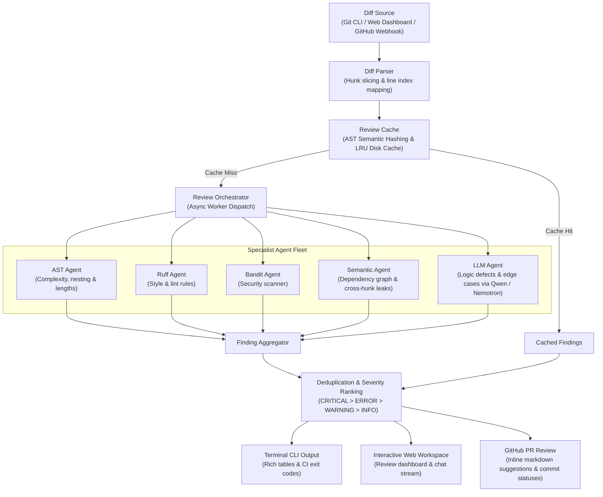

# Nexarion

Nexarion is an automated code review platform that inspects code diffs and GitHub pull requests using a team of specialized review agents. Instead of throwing an entire diff at a single generic prompt or relying exclusively on static linters, Nexarion coordinates multiple deterministic analyzers alongside an LLM to catch security bugs, architectural regressions, and maintainability issues.

GitHub Repository: [https://github.com/kaushalkr585-cmd/Nexarion-](https://github.com/kaushalkr585-cmd/Nexarion-)

---

## Why I Built This

Most automated code reviews fall into two extremes:

1. **Standard linters and SAST tools** (like Ruff, Flake8, or Bandit) are fast and consistent, but they only inspect syntax and known pattern signatures. They have zero understanding of system architecture, variable lifecycles across hunks, or business logic.
2. **Single-prompt LLM reviewers** tend to be verbose, frequently hallucinate comments on lines that were never modified, and miss basic deterministic bugs that a 5ms static check would have caught immediately.

I built Nexarion to combine the best parts of both worlds. Deterministic agents handle what static analysis does best (syntax standards, security warnings, cyclomatic complexity, and call-graph cycles). An LLM agent then focuses on semantic logic, missing edge cases, and architectural context—constrained strictly to changed diff lines so it doesn't invent issues out of thin air.

---

## How It Works

Nexarion takes a unified git diff from your terminal, an ad-hoc paste, or a GitHub pull request webhook and processes it through an orchestrator pipeline:



### Review Pipeline Steps

1. **Diff Parsing & Line Mapping:** The incoming diff is parsed into structured files and hunks using `unidiff`. An absolute line-mapping table is generated so agents only comment on added or modified lines.
2. **AST Semantic Hashing & Cache Lookup:** Before running any agents, the diff is fingerprinted. Nexarion normalizes whitespace and comments in Python syntax trees. If a PR update only changed docstrings or indentation without altering code semantics, cached findings are served instantly.
3. **Concurrent Agent Dispatch:** The orchestrator runs all enabled specialist agents concurrently using `asyncio` worker threads with configurable concurrency limits.
4. **Anti-Hallucination Line Enforcement:** Any finding produced by the LLM agent is cross-referenced against the diff hunk line index. If the model claims an error on line 420 of a file where only lines 10–25 were changed, the finding is discarded before it reaches the user.
5. **Deduplication & Sorting:** Overlapping issues reported by different tools (e.g., both Bandit and the LLM flagging an unescaped SQL query) are deduplicated by file, line number, and rule intent. The highest severity finding is retained with the most actionable suggested fix.
6. **Result Delivery:** Results are formatted for terminal output (`code-review`), returned to the web dashboard, or posted directly onto the GitHub pull request as inline review comments with ````suggestion```` markdown blocks.

---

## Features

### Multi-Agent Review Fleet
* **AST Agent:** Inspects Python Abstract Syntax Trees for deep nesting, oversized functions, high cyclomatic complexity, and dangerous wildcard imports (`from module import *`).
* **Ruff Agent:** Runs Ruff in JSON output mode and filters diagnostics strictly to lines touched in the diff.
* **Bandit Agent:** Scans for hardcoded credentials, insecure crypto algorithms, shell injection vulnerabilities, and weak random number generators.
* **Semantic Agent (Cross-File & Multi-Hunk):**
  * Builds an AST symbol table and cross-file dependency graph.
  * Catches circular imports (`SEM001`), missing imports or unresolved symbols (`SEM002`), function call signature mismatches (`SEM003`), and dead public exports (`SEM004`).
  * Identifies unclosed resources opened in one hunk and discarded in another (`SEM005`), cross-hunk variable collisions (`SEM006`), and swallowed exceptions (`SEM008`).
* **LLM Agent:** Explains complex logic bugs, boundary conditions, and design oversights. Supports dual backends:
  * **Ollama (local):** Runs `qwen2.5-coder:7b` (or any compatible model) completely offline.
  * **NVIDIA NIM (cloud):** Connects to `nvidia/nemotron-3-ultra-550b-a55b` or Llama models with free cloud API keys for zero-GPU deployments.

### Developer Tooling & Web Workspace
* **CLI Interface (`code-review`):** Inspect uncommitted changes, staged changes (`--staged`), or compare against another branch (`--branch main`). Features clean terminal tables powered by `rich` and configurable CI exit codes (`--fail-on error`).
* **Interactive Web Dashboard:** A responsive React workspace with dark theme, review summaries, pull request listings, and an agent toggle manager.
* **Interactive AI Chat:** Real-time Server-Sent Events (SSE) streaming chat workspace with conversational memory, document attachments (extracting text from PDFs and code files using PyMuPDF), and conversation history search (`Ctrl + K`).
* **GitHub Integration:** Webhook receiver with HMAC-SHA256 signature verification, background review dispatch, GitHub Commit Status reporting (`pending`/`success`/`failure`), and inline PR comments with clickable suggestion diffs.

---

## Tech Stack

| Component | Technologies | Purpose in Nexarion |
| :--- | :--- | :--- |
| **Backend API** | FastAPI, Uvicorn, Python 3.12 | REST API, SSE streaming endpoints, auth routes, webhooks |
| **Data Validation** | Pydantic v2, Pydantic-Settings | Strongly-typed settings, request schemas, and finding contracts |
| **Static Analyzers** | Ruff, Bandit, Python `ast` | Deterministic linting, security scans, and AST complexity metrics |
| **Semantic Engine** | `unidiff`, custom symbol graph | Diff hunk slicing, cross-file symbol references, resource tracking |
| **Database & ORM** | PostgreSQL, SQLite, SQLAlchemy 2.0 | User profiles, review history, conversations, agent configs |
| **Authentication** | PyJWT, Passlib (Bcrypt) | Access tokens, password hashing, and Google OAuth flow |
| **LLM Inference** | Ollama, NVIDIA NIM, HTTPX | Local offline model runner and cloud API fallback |
| **Document Parsing** | PyMuPDF (fitz) | Extracting context from uploaded PDF reports and code files |
| **Frontend UI** | React 18, TypeScript, Tailwind CSS, Vite | Responsive web dashboard, chat UI, diff viewer, review cards |
| **Containerization** | Docker (multi-stage), Docker Compose | Single-container fullstack deployment and local PostgreSQL service |
| **Testing & CI/CD** | Pytest, Pytest-cov, GitHub Actions | 439 backend unit tests, 42 frontend tests, Ruff and Bandit CI jobs |

---

## Project Structure

```
.
├── .github/
│   └── workflows/
│       └── ci.yml                 # GitHub Actions pipeline (Ruff, Bandit, Pytest matrix, Docker build)
├── docs/                          # Architectural specifications and milestone documentation
│   ├── ROADMAP.md                 # Complete project roadmap and milestones
│   └── milestone_1.md to 11.md    # Detailed specifications for each development phase
├── frontend/                      # React 18 + TypeScript + Vite web dashboard
│   ├── src/
│   │   ├── components/
│   │   │   ├── chat/              # Chat workspace, SSE streaming, search modal, send button
│   │   │   ├── github/            # PR picker and GitHub integration modals
│   │   │   ├── layout/            # Sidebar navigation, context menus, headers
│   │   │   └── reviews/           # Diff composer, finding cards, metrics summary
│   │   ├── services/              # API client methods (conversations, reviews, GitHub, auth)
│   │   └── types.ts               # Shared TypeScript models and response interfaces
│   ├── package.json
│   └── vite.config.ts
├── src/
│   └── code_review/               # Core Python package
│       ├── agents/                # Specialist review agents (AST, Ruff, Bandit, Semantic, LLM)
│       ├── analysis/              # Dependency graph, AST hasher, symbol table, document processor
│       ├── cache/                 # In-memory LRU and persistent disk cache implementations
│       ├── cli/                   # Terminal application (argument parser, git helpers, rich tables)
│       ├── db/                    # SQLAlchemy database models, session engine, PostgreSQL seeds
│       ├── github/                # GitHub REST API client, webhook handlers, PR comment posters
│       ├── llm/                   # Ollama and NVIDIA NIM client integrations and prompt templates
│       ├── models/                # Pydantic data schemas (Finding, ReviewResult, Enums)
│       ├── parsers/               # Unified diff parser and hunk line mapper
│       ├── web/                   # FastAPI application, routers, error handlers, auth middleware
│       ├── config.py              # Central application settings via pydantic-settings
│       ├── orchestrator.py        # Multi-agent concurrency, deduplication, and severity ranking
│       └── __main__.py            # Module entry point (`python -m code_review`)
├── tests/                         # Comprehensive pytest test suite (439 tests)
│   ├── fixtures/                  # Deterministic code and diff fixtures
│   ├── test_ast_agent.py          # AST rules and complexity tests
│   ├── test_bandit_agent.py       # Security scanning tests
│   ├── test_cache.py              # Cache eviction, TTL, and hashing tests
│   ├── test_cli.py                # Command-line interface and quality gate tests
│   ├── test_conversation_search.py# Conversation search and ownership isolation tests
│   ├── test_github_integration.py # Webhook signature and PR comment tests
│   ├── test_orchestrator.py       # Concurrent dispatch and deduplication tests
│   ├── test_ruff_agent.py         # Linting and diff filtering tests
│   ├── test_semantic_agent.py     # Cross-file imports and multi-hunk leak tests
│   └── test_web_api.py            # FastAPI route tests and database cascades
├── docker-compose.yml             # Local Docker Compose environment (PostgreSQL + Nexarion)
├── Dockerfile                     # Multi-stage production container build (Node builder + Python runtime)
├── pyproject.toml                 # Hatchling build configuration, dependencies, and tool settings
├── render.yaml                    # Cloud deployment blueprint
└── .env.example                   # Environment variable template
```

---

## Getting Started

### Prerequisites

* **Python:** 3.11 or 3.12
* **Node.js:** 20+ and npm
* **Git** installed and available in your PATH
* **Optional:** Docker and Docker Compose
* **Optional:** [Ollama](https://ollama.com/) if you want to run models locally without any cloud API keys.

---

### Local Installation (Windows PowerShell)

#### 1. Clone the repository

```powershell
git clone https://github.com/kaushalkr585-cmd/Nexarion-.git
cd Nexarion-
```

#### 2. Set up the Python virtual environment

```powershell
python -m venv .venv
.\.venv\Scripts\Activate.ps1
python -m pip install --upgrade pip
pip install -e ".[dev]"
```

#### 3. Configure environment variables

Copy the example environment configuration:

```powershell
Copy-Item .env.example .env
```

Open `.env` in your editor and adjust settings. By default, SQLite is used automatically if you don't supply a PostgreSQL `DATABASE_URL`.

For local AI analysis with Ollama:
```ini
LLM_PROVIDER=ollama
OLLAMA_BASE_URL=http://localhost:11434
OLLAMA_MODEL=qwen2.5-coder:7b
```

Or for free cloud inference with NVIDIA NIM:
```ini
LLM_PROVIDER=nvidia
NVIDIA_API_KEY=your_nvidia_api_key_here
NVIDIA_MODEL=nvidia/nemotron-3-ultra-550b-a55b
```

#### 4. Build the frontend dashboard

```powershell
cd frontend
npm install
npm run build
cd ..
```

#### 5. Start the application

Run the backend server:

```powershell
uvicorn code_review.web.app:app --reload --port 8000
```

If you are developing the frontend with hot-reloading:

```powershell
cd frontend
npm run dev
```

Visit the dashboard in your browser at `http://localhost:5173` (or `http://localhost:8000` when serving the compiled bundle).

---

### Running with Docker

Nexarion provides a multi-stage `Dockerfile` and `docker-compose.yml` that boots both PostgreSQL 16 and the web application:

```powershell
docker compose up --build
```

The containerized service will be available at `http://localhost:8000`.

---

## Using the CLI

Once installed in editable mode (`pip install -e .`), the `code-review` command is available in your virtual environment:

```powershell
# Review uncommitted working tree changes
code-review

# Review staged git changes only
code-review --staged

# Review changes compared to another branch
code-review --branch main

# Review a specific diff file directly
code-review path/to/changes.diff

# Pipe git diff directly through standard input
git diff origin/main...HEAD | code-review

# Enforce quality gates for CI (exits with code 1 if critical/error issues exist)
code-review --fail-on error

# Run only specific agents
code-review --agents bandit,ast,semantic
```

---

## Environment Variables

All settings are managed via Pydantic in `src/code_review/config.py`. Here is a breakdown of what each variable does:

| Variable | Default Value | Description |
| :--- | :--- | :--- |
| `APP_NAME` | `nexarion` | Name identifier for logging and application telemetry |
| `LOG_LEVEL` | `INFO` | Console log verbosity (`DEBUG`, `INFO`, `WARNING`, `ERROR`) |
| `DEBUG` | `false` | Enables reloaders and verbose error stack traces |
| `PORT` | `8000` | Port on which the FastAPI server listens |
| `SESSION_SECRET` | *(required in prod)* | Secret key used to sign and verify JWT authentication tokens |
| `DATABASE_URL` | `postgresql+psycopg://...` | Connection URI. If unconfigured or unavailable, falls back gracefully to local SQLite |
| `FRONTEND_URL` | `http://localhost:5173` | Allowed CORS origin for frontend requests |
| `LLM_PROVIDER` | `ollama` | Active LLM service: `ollama` (local) or `nvidia` (cloud API) |
| `OLLAMA_BASE_URL`| `http://localhost:11434`| HTTP endpoint for your local Ollama server |
| `OLLAMA_MODEL` | `qwen2.5-coder:7b` | Model tag pulled in Ollama (`ollama pull qwen2.5-coder:7b`) |
| `NVIDIA_API_KEY` | `""` | Free cloud API key from build.nvidia.com |
| `NVIDIA_MODEL` | `nvidia/nemotron-3-ultra-550b-a55b` | Active cloud model identifier on NVIDIA NIM |
| `NVIDIA_BASE_URL`| `https://integrate.api.nvidia.com/v1` | Endpoint for NVIDIA NIM OpenAI-compatible API |
| `LLM_TIMEOUT_SECONDS` | `60.0` | Timeout before an unresponsive LLM request fails gracefully |
| `CACHE_ENABLED` | `true` | Toggles review caching layer on or off |
| `CACHE_BACKEND` | `disk` | Cache driver: `memory` or `disk` |
| `CACHE_TTL_SECONDS` | `86400` | Retention window for cached review findings (24 hours) |
| `CLOUDINARY_*` | `""` | Optional credentials for user avatar uploads |
| `GOOGLE_*` | `""` | Optional client ID and secret for Google OAuth sign-in |
| `GITHUB_TOKEN` | `""` | GitHub Personal Access Token or App token used to fetch diffs and post review comments |
| `GITHUB_WEBHOOK_SECRET` | `""` | Shared secret to verify incoming GitHub webhook HMAC-SHA256 signatures |

---

## Running the Tests

The test suite covers models, diff parsing, deterministic tools, the orchestrator, caching, web routes, and CLI commands.

### Backend Tests (Pytest)

Run all 439 tests:

```powershell
pytest
```

Run tests with line-by-line coverage analysis:

```powershell
pytest --cov=code_review --cov-report=term-missing
```

Run code formatting and linting checks:

```powershell
ruff check src/ tests/
ruff format --check src/ tests/
bandit -r src -ll
```

### Frontend Tests (Node test runner)

Run all 42 frontend unit and component tests:

```powershell
cd frontend
npm test
```

---

## Roadmap

* **Completed:**
  * Multi-agent deterministic review pipeline (`ASTAgent`, `RuffAgent`, `BanditAgent`).
  * Review orchestrator with concurrent execution, fuzzy deduplication, and severity sorting.
  * Local and cloud LLM review agent with anti-hallucination diff line filtering (Ollama & NVIDIA NIM).
  * Command-line tool (`code-review`) with Rich terminal tables and CI quality gate exit codes.
  * Interactive web dashboard (React 18 + TypeScript + Vite + Tailwind) and FastAPI backend.
  * Advanced cross-file semantic analysis (dependency graph, broken imports, signature checks, multi-hunk leaks).
  * Two-tier caching (in-memory LRU + atomic disk cache) with AST semantic hashing.
  * Multi-stage production `Dockerfile`, `docker-compose.yml`, and GitHub Actions CI matrix.
  * GitHub PR integration (webhook receiver, HMAC validation, and inline code suggestion comments).
  * Interactive AI workspace with document attachment processing (PyMuPDF), chat history search (`Ctrl + K`), and conversational memory.

* **In Progress:**
  * Expanding cross-file symbol extraction to TypeScript and JavaScript codebases.
  * One-click GitHub PR autofix bot to apply suggested fixes directly to PR branches.

* **Planned:**
  * Pull request risk scoring based on historical repository churn and commit patterns.
  * Custom user-defined review rules via declarative YAML configurations.

---

## Limitations

* **Python-Centric Static Analysis:** The deterministic static agents (Bandit, AST, Ruff) and the cross-file dependency graph currently analyze Python codebases. While diff parsing and the LLM agent review any programming language, deep symbol table analysis is currently Python-focused.
* **Local Hardware Demands:** Running local LLMs (like `qwen2.5-coder:7b`) via Ollama requires at least 8GB to 16GB of system RAM or a dedicated GPU. If you are on an older laptop or hosting on free cloud tiers (like Render or Railway), use the NVIDIA NIM cloud provider instead.
* **Local Webhook Ingress:** GitHub webhooks require a publicly accessible endpoint. For local development, you must expose port 8000 using an ingress tunnel like `ngrok` or `smee.io`.

---

## Contributing

Contributions, bug reports, and suggestions are welcome.

1. Fork the repository.
2. Create a dedicated feature branch (`git checkout -b feature/my-new-feature`).
3. Commit your changes with clear messages.
4. Verify that all tests pass and code is formatted cleanly:
   ```powershell
   ruff check src/ tests/
   pytest
   npm --prefix frontend test
   ```
5. Push to your branch and open a Pull Request.

---

## License

Licensing information is not yet available for this project.
