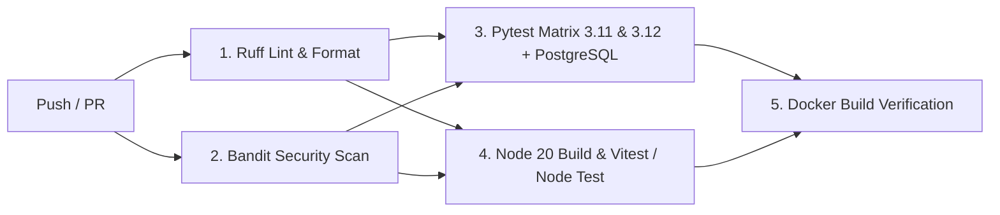

# Milestone 10 — Testing, Docker & CI/CD

**Status:**  Complete
**Tests:** 353 total passing (100% pass rate, coverage >= 80%)
**Linters:** Ruff clean (0 errors, 100% formatted)
**Security:** Bandit clean (0 medium/high vulnerabilities)

---

## 1. Overview & Objective

Milestone 10 transitions NEXARION from a local development codebase into a containerized, continuously integrated, and production-deployable software platform.

As modern AI code review systems scale across engineering organizations:
1. **Reproducible Environments**: Dependencies, system binaries (`git`, `curl`), and Python interpreters must be strictly encapsulated so behavior in development matches staging and production.
2. **Unified Single-Command Deployment**: The platform consists of a React 19 SPA frontend, a FastAPI ASGI backend, a PostgreSQL relational store, and an Ollama LLM inference service. Orchestrating these via `docker-compose.yml` allows instant local and server spin-up.
3. **Automated Quality & Security Gates**: Every commit and pull request must automatically pass linting (`ruff`), format checks, security scans (`bandit`), frontend tests, backend pytest suites across Python matrix versions with live PostgreSQL services, and Docker image build verifications.

---

## 2. Architecture & Container Orchestration

```mermaid
flowchart TD
    subgraph Host / Cloud Deployment
        DC[docker compose up]
    end

    subgraph Container Network: nexarion-network
        subgraph Multi-Stage App Container
            F_BUILD[Node 20 Builder: npm run build] -->|static assets| SPA_DIST[/app/frontend/dist]
            PY_BASE[Python 3.12 Slim] --> APP_RUN[Uvicorn ASGI Server :8000]
            SPA_DIST --> APP_RUN
            APP_RUN --> PROBE[HEALTHCHECK /health]
        end

        subgraph Database Service
            PG[(PostgreSQL 16 Alpine :5432)]
            PG_VOL[(Volume: nexarion_postgres_data)] --- PG
            PG_HEALTH[Healthcheck: pg_isready] --> PG
        end

        subgraph Local Inference Service
            OLLAMA[Ollama Server :11434]
            OLLAMA_VOL[(Volume: nexarion_ollama_data)] --- OLLAMA
        end
    end

    DC --> PG
    PG_HEALTH -->|condition: service_healthy| APP_RUN
    DC --> OLLAMA
    APP_RUN <-->|SQLAlchemy + Psycopg 3| PG
    APP_RUN <-->|HTTP REST / Streaming| OLLAMA
    USER((Developer / Browser)) -->|Port 8000| APP_RUN
```

---

## 3. Components & Files Created / Modified

| File | Type | Purpose |
|------|------|---------|
| [`Dockerfile`](file:///e:/Projects/Multi%20Agent%20Code%20Review%20System/Dockerfile) | Created | Multi-stage production container: Node 20 builder + Python 3.12 slim runtime with non-root `appuser` and health probes. |
| [`docker-compose.yml`](file:///e:/Projects/Multi%20Agent%20Code%20Review%20System/docker-compose.yml) | Created | Production compose stack orchestrating PostgreSQL 16, Ollama LLM, and the unified NEXARION application. |
| [`.dockerignore`](file:///e:/Projects/Multi%20Agent%20Code%20Review%20System/.dockerignore) | Created | Excludes caches, virtual environments, node modules, build artifacts, and secrets from Docker contexts. |
| [`frontend/Dockerfile`](file:///e:/Projects/Multi%20Agent%20Code%20Review%20System/frontend/Dockerfile) | Created | Standalone frontend container option using Nginx Alpine with multi-stage Vite build. |
| [`frontend/nginx.conf`](file:///e:/Projects/Multi%20Agent%20Code%20Review%20System/frontend/nginx.conf) | Created | Production Nginx reverse-proxy configuration with gzip compression, security headers, and `/api/` routing. |
| [`.github/workflows/ci.yml`](file:///e:/Projects/Multi%20Agent%20Code%20Review%20System/.github/workflows/ci.yml) | Created | Complete GitHub Actions workflow: Ruff lint, Bandit security, Python 3.11/3.12 matrix with PostgreSQL service, frontend tests, and Docker verification. |
| [`pyproject.toml`](file:///e:/Projects/Multi%20Agent%20Code%20Review%20System/pyproject.toml) | Modified | Declared all runtime dependencies (FastAPI, SQLAlchemy, Psycopg, PyJWT, Bcrypt, Rich, etc.), coverage configuration, bandit rules, and Ruff scopes. |
| [`src/code_review/web/app.py`](file:///e:/Projects/Multi%20Agent%20Code%20Review%20System/src/code_review/web/app.py) | Modified | Added root-level `/health` route alias for container liveness and readiness health checks. |
| [`src/code_review/analysis/patterns.py`](file:///e:/Projects/Multi%20Agent%20Code%20Review%20System/src/code_review/analysis/patterns.py) | Modified | Upgraded code-clone hashing from MD5 to SHA-256 for cryptographic security compliance. |
| [`src/code_review/llm/client.py`](file:///e:/Projects/Multi%20Agent%20Code%20Review%20System/src/code_review/llm/client.py) | Modified | Added `# nosec B310` annotations on validated internal Ollama HTTP calls. |
| [`src/code_review/llm/nemotron_client.py`](file:///e:/Projects/Multi%20Agent%20Code%20Review%20System/src/code_review/llm/nemotron_client.py) | Modified | Added `# nosec B310` annotations on validated internal NVIDIA NIM HTTP calls. |
| [`tests/test_health_and_deployment.py`](file:///e:/Projects/Multi%20Agent%20Code%20Review%20System/tests/test_health_and_deployment.py) | Created | 6 new unit tests for health endpoints, SPA static routing, database seeding, and Docker/CI integrity. |
| [`docs/ROADMAP.md`](file:///e:/Projects/Multi%20Agent%20Code%20Review%20System/docs/ROADMAP.md) | Modified | Updated Milestone 10 status to Complete and set Milestone 11 as Next. |

---

## 4. CI/CD Pipeline Architecture

The GitHub Actions workflow defined in [`.github/workflows/ci.yml`](file:///e:/Projects/Multi%20Agent%20Code%20Review%20System/.github/workflows/ci.yml) enforces a 5-stage continuous quality gate:



### Stage Summary
1. **Lint & Format (`lint-and-format`)**:
   - Executes `ruff check .` across `src/`, `tests/`, and `scripts/`.
   - Executes `ruff format --check .` ensuring strict code style compliance.
2. **Security Static Analysis (`security-scan`)**:
   - Executes `bandit -r src -ll` scanning for medium and high-severity CWE vulnerabilities (SQL injection, unsafe shell processes, insecure hashes).
3. **Backend Matrix Testing (`backend-tests`)**:
   - Runs against both **Python 3.11** and **Python 3.12**.
   - Boots a dedicated **PostgreSQL 16 Alpine** container service with healthcheck synchronization.
   - Executes `pytest --cov=code_review --cov-report=xml --cov-report=term-missing` enforcing `>= 80%` test coverage.
   - Stores `coverage.xml` as a GitHub Actions build artifact.
4. **Frontend Build & Tests (`frontend-tests`)**:
   - Executes `npm install` and compiles the production bundle via `npm run build` (`tsc -b && vite build`).
   - Runs frontend unit tests via `npm test`.
5. **Docker Build Verification (`docker-build`)**:
   - Uses `docker/setup-buildx-action` and `docker/build-push-action` to test that the multi-stage `Dockerfile` compiles cleanly with GHA caching.

---

## 5. Deployment Guide

### Running with Docker Compose (Recommended)
```bash

git clone https://github.com/your-org/nexarion.git
cd nexarion

docker compose up --build -d

docker compose ps

docker exec -it nexarion-ollama ollama pull qwen2.5-coder:7b

open http://localhost:8000
```

### Health Check Probes
- Application Health: `curl -f http://localhost:8000/health`
- API Health: `curl -f http://localhost:8000/api/health`
