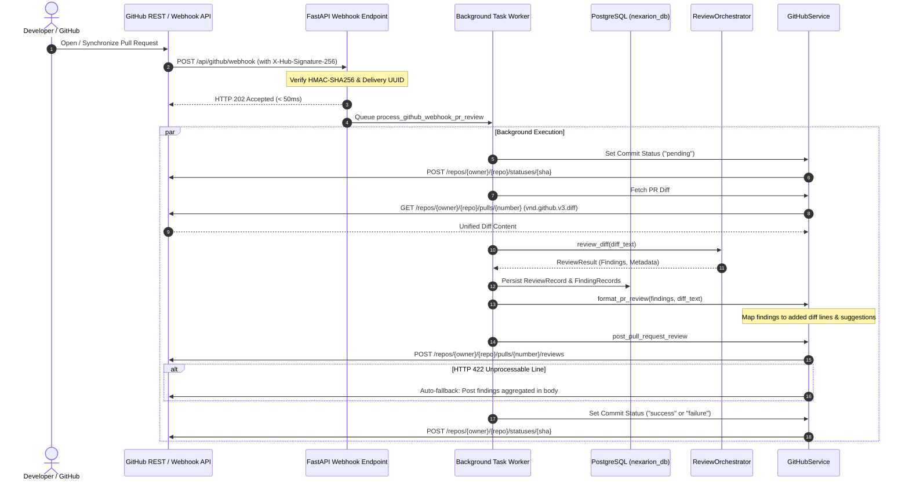

# Milestone 11 — GitHub Integration

**Status:** [Complete] Complete
**Tests:** 13 new unit & integration tests (366 total passing, 100% pass rate)
**Linters:** Ruff clean (0 errors, 100% formatted)

---

## 1. Overview & Objective

Milestone 11 connects NEXARION directly to GitHub repositories as an automated, event-driven code review bot:
1. **GitHub Webhook Ingestion**: Receives repository events (`pull_request.opened`, `pull_request.synchronize`, `pull_request.reopened`, `ping`).
2. **HMAC-SHA256 Signature Security**: Cryptographically verifies the `X-Hub-Signature-256` header using constant-time comparison to ensure requests originate from GitHub.
3. **Delivery Deduplication**: Detects and suppresses duplicate webhook deliveries using `X-GitHub-Delivery` UUID tracking with TTL caching.
4. **Fast Acknowledgment (< 100ms)**: Returns HTTP 202 Accepted immediately to respect GitHub's 10-second webhook timeout SLA, dispatching review workloads to background workers.
5. **Automated Multi-Agent PR Reviews**: Background workers fetch unified diffs, run the full multi-agent suite (AST, Ruff, Bandit, Semantic, and LLM), persist records to PostgreSQL, and post reviews back to GitHub.
6. **Structured Markdown & Inline Comment Suggestions**: Formats reviews with summary tables, severity breakdown badges, and line-level comments featuring GitHub code suggestion diff blocks (` ```suggestion `).
7. **Resilient Error Handling**: Automatically catches HTTP 422 errors if inline line mappings fall outside changed diff hunks and compiles findings into the review body so review data is never lost.
8. **GitHub Commit Statuses**: Sets commit status checks (`pending` when review begins, `success` or `failure` based on critical issues).
9. **Interactive Dashboard Publishing**: Exposes `POST /api/github/repos/{owner}/{repo}/pulls/{number}/post-review` for manual one-click review publishing from the NEXARION UI.

---



---

| File | Type | Purpose |
|------|------|---------|
| [`src/code_review/github/service.py`](file:///e:/Projects/Multi%20Agent%20Code%20Review%20System/src/code_review/github/service.py) | Modified | Added `verify_webhook_signature`, `format_pr_review` (with inline comment & suggestion mapping), `post_pull_request_review` (with 422 fallback resilience), `create_commit_status`, and `create_check_run`. |
| [`src/code_review/web/routes/github_routes.py`](file:///e:/Projects/Multi%20Agent%20Code%20Review%20System/src/code_review/web/routes/github_routes.py) | Modified | Added `POST /api/github/webhook` with HMAC-SHA256 validation, delivery deduplication, fast 202 response, background worker, and `POST /api/github/repos/{owner}/{repo}/pulls/{number}/post-review`. |
| [`src/code_review/config.py`](file:///e:/Projects/Multi%20Agent%20Code%20Review%20System/src/code_review/config.py) | Modified | Added GitHub settings: `github_app_id`, `github_app_private_key`, `github_auto_review`, `github_post_review_comments`, `github_set_commit_status`, `github_dashboard_url`. |
| [`frontend/src/services/api.ts`](file:///e:/Projects/Multi%20Agent%20Code%20Review%20System/frontend/src/services/api.ts) | Modified | Added `postReview` and `postToGithub` query support in `githubApi`. |
| [`tests/test_github_integration.py`](file:///e:/Projects/Multi%20Agent%20Code%20Review%20System/tests/test_github_integration.py) | Created | 13 unit and integration tests covering signatures, deduplication, ping, pull requests, formatting, line mapping, 422 fallback, commit statuses, and background execution. |
| [`docs/milestone_11.md`](file:///e:/Projects/Multi%20Agent%20Code%20Review%20System/docs/milestone_11.md) | Created | Architectural documentation, sequence diagrams, and verification summary. |
| [`docs/ROADMAP.md`](file:///e:/Projects/Multi%20Agent%20Code%20Review%20System/docs/ROADMAP.md) | Modified | Updated Milestone 11 status to Complete. |

---

To safeguard against unauthorized forged requests:
```python
expected_hash = hmac.new(
    secret.encode("utf-8"),
    payload_bytes,
    hashlib.sha256,
).hexdigest()
received_hash = signature_header[7:].strip()
return hmac.compare_digest(expected_hash, received_hash)
```
- Uses `hmac.compare_digest` to prevent timing side-channel attacks.
- Operates on raw byte payloads before JSON parsing.

GitHub API rejects review comments if `line` does not belong to a diff hunk:
1. `format_pr_review` uses `parse_diff(diff_text)` to map valid line numbers on added/modified lines.
2. If `suggested_fix` exists, formats the comment with a GitHub suggestion code block:
   ````markdown
   **[CRITICAL] bandit**: Possible SQL injection in query [B608]
   *Found by `bandit` agent*

   ```suggestion
   execute_sql('SELECT * FROM users WHERE name = :user', {'user': user})
   ```
   ````
3. Any finding not placed on a changed line (such as cross-file imports or architectural warnings) is bundled under a collapsible `<details><summary>Structural Findings</summary></details>` section in the main review body.

If GitHub's API returns `422 Unprocessable Entity` due to line position conflicts:
```python
if err.response.status_code == 422 and comments:
    fallback_body = body + "\n\n### Inline Findings (Aggregated Fallback)\n"
    for c in comments:
        fallback_body += f"\n- `{c['path']}:{c.get('line', '?')}`: {c['body']}"
    return client.post(url, json={"body": fallback_body, "event": event})
```
This ensures zero review loss even under unexpected git branch rebases.

---

Run the test suite:
```bash
.venv\Scripts\python.exe -m pytest tests/test_github_integration.py -v
```

All 13 integration tests pass cleanly:
- `test_verify_webhook_signature_valid` [Complete]
- `test_verify_webhook_signature_invalid` [Complete]
- `test_verify_webhook_signature_malformed` [Complete]
- `test_delivery_deduplication` [Complete]
- `test_webhook_rejected_when_signature_invalid` [Complete]
- `test_webhook_ping_event_accepted` [Complete]
- `test_webhook_pr_opened_dispatches_fast_202` [Complete]
- `test_webhook_pr_unmonitored_action_ignored` [Complete]
- `test_format_pr_review_with_inline_and_suggestions` [Complete]
- `test_post_pull_request_review_resilience_422_fallback` [Complete]
- `test_create_commit_status` [Complete]
- `test_manual_post_review_endpoint` [Complete]
- `test_background_webhook_review_saves_and_publishes` [Complete]
