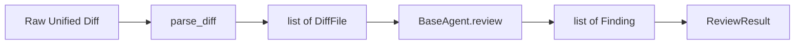

# Milestone 2 — Data Models, Diff Parsing & Agent Interface

**Status:** Complete
**Tests:** 61 new tests (74 total passing)
**Linter:** Ruff clean

---

## 1. Overview & Objective

Milestone 2 establishes the core contracts and data communication pipelines of the review system. Before any specialized agents can be built, the system requires:
1. Standardized data schemas for issues found and review summaries.
2. A parser to translate raw Git unified diffs into structured Python objects with line-mapping capabilities.
3. An abstract agent interface (`BaseAgent`) ensuring all review agents expose a uniform API to the orchestrator.

---

## 2. Components & Files Created

| File | Type | Purpose |
|------|------|---------|
| [`src/code_review/models/enums.py`](file:///e:/Projects/Multi%20Agent%20Code%20Review%20System/src/code_review/models/enums.py) | Data Enums | Defines `Severity` (`CRITICAL`, `HIGH`, `MEDIUM`, `LOW`, `INFO`), `Category` (`SECURITY`, `BUG`, `PERFORMANCE`, `STYLE`, `DOCUMENTATION`), `AgentType` (`AST`, `RUFF`, `BANDIT`, `LLM`), and helper `severity_rank()`. |
| [`src/code_review/models/finding.py`](file:///e:/Projects/Multi%20Agent%20Code%20Review%20System/src/code_review/models/finding.py) | Pydantic Model | Immutable (`frozen=True`) model representing a single review issue. Contains `file`, `line`, `severity`, `category`, `agent`, `message`, optional `suggestion`, and `rule_id`. Validates line numbers (> 0) and non-empty messages. |
| [`src/code_review/models/review.py`](file:///e:/Projects/Multi%20Agent%20Code%20Review%20System/src/code_review/models/review.py) | Pydantic Model | Top-level review result aggregating findings. Provides computed helpers: `total_findings`, `has_critical`, `findings_by_severity`, and `sorted_findings(ascending=False)`. Includes UTC timestamps and execution duration tracking. |
| [`src/code_review/models/__init__.py`](file:///e:/Projects/Multi%20Agent%20Code%20Review%20System/src/code_review/models/__init__.py) | Package Init | Public models API re-exporting `Severity`, `Category`, `AgentType`, `Finding`, and `ReviewResult`. |
| [`src/code_review/parsers/diff_parser.py`](file:///e:/Projects/Multi%20Agent%20Code%20Review%20System/src/code_review/parsers/diff_parser.py) | Diff Parsing | Wraps `unidiff.PatchSet` to parse unified diff text into frozen models: `LineType`, `DiffLine`, `DiffHunk`, and `DiffFile`. Provides `added_lines`, `removed_lines`, and `added_line_numbers` helper properties. |
| [`src/code_review/parsers/__init__.py`](file:///e:/Projects/Multi%20Agent%20Code%20Review%20System/src/code_review/parsers/__init__.py) | Package Init | Public parsers API re-exporting `parse_diff`, `DiffFile`, `DiffHunk`, `DiffLine`, and `LineType`. |
| [`src/code_review/agents/base.py`](file:///e:/Projects/Multi%20Agent%20Code%20Review%20System/src/code_review/agents/base.py) | Abstract Interface | Abstract Base Class (`BaseAgent`) defining the contract for all review agents: requires `agent_type` property and `review(diff_files: list[DiffFile]) -> list[Finding]`. |
| [`src/code_review/agents/__init__.py`](file:///e:/Projects/Multi%20Agent%20Code%20Review%20System/src/code_review/agents/__init__.py) | Package Init | Public agents API re-exporting `BaseAgent`. |
| [`tests/fixtures/sample.diff`](file:///e:/Projects/Multi%20Agent%20Code%20Review%20System/tests/fixtures/sample.diff) | Test Fixture | Unified diff for a single file with multiple hunks. |
| [`tests/fixtures/multi_file.diff`](file:///e:/Projects/Multi%20Agent%20Code%20Review%20System/tests/fixtures/multi_file.diff) | Test Fixture | Multi-file unified diff. |
| [`tests/test_models.py`](file:///e:/Projects/Multi%20Agent%20Code%20Review%20System/tests/test_models.py) | Unit Tests | 27 tests covering model creation, immutability, validation constraints, computed properties, and JSON serialization round-tripping. |
| [`tests/test_diff_parser.py`](file:///e:/Projects/Multi%20Agent%20Code%20Review%20System/tests/test_diff_parser.py) | Unit Tests | 26 tests covering diff parsing, path extraction, hunk ranges, line classification, and inline diff handling. |
| [`tests/test_base_agent.py`](file:///e:/Projects/Multi%20Agent%20Code%20Review%20System/tests/test_base_agent.py) | Unit Tests | 8 tests verifying abstract enforcement (cannot instantiate BaseAgent directly) and verifying concrete subclassing. |

---

## 3. Architecture & Data Flow



### Key Design Decisions
- **Immutable Models (`frozen=True`)**: `Finding`, `DiffLine`, `DiffHunk`, and `DiffFile` cannot be mutated once constructed, preventing race conditions during concurrent agent reviews.
- **Line Mapping**: Agents should only comment on lines added or touched by the PR. `DiffFile.added_line_numbers` provides an `O(1)` lookup set of modified lines in the target file.
- **Abstract Base Class vs Protocol**: An explicit ABC (`abc.ABC`) fails fast at subclass instantiation time if `review()` or `agent_type` is omitted, providing clear debugging feedback.

---

## 4. Dependencies Introduced

| Dependency | Category | Purpose |
|------------|----------|---------|
| `unidiff` | Core | Parses Git unified diff outputs into structured hunk and line objects. |

---

## 5. Verification Commands

```powershell

pytest -v

ruff check src/ tests/
```
