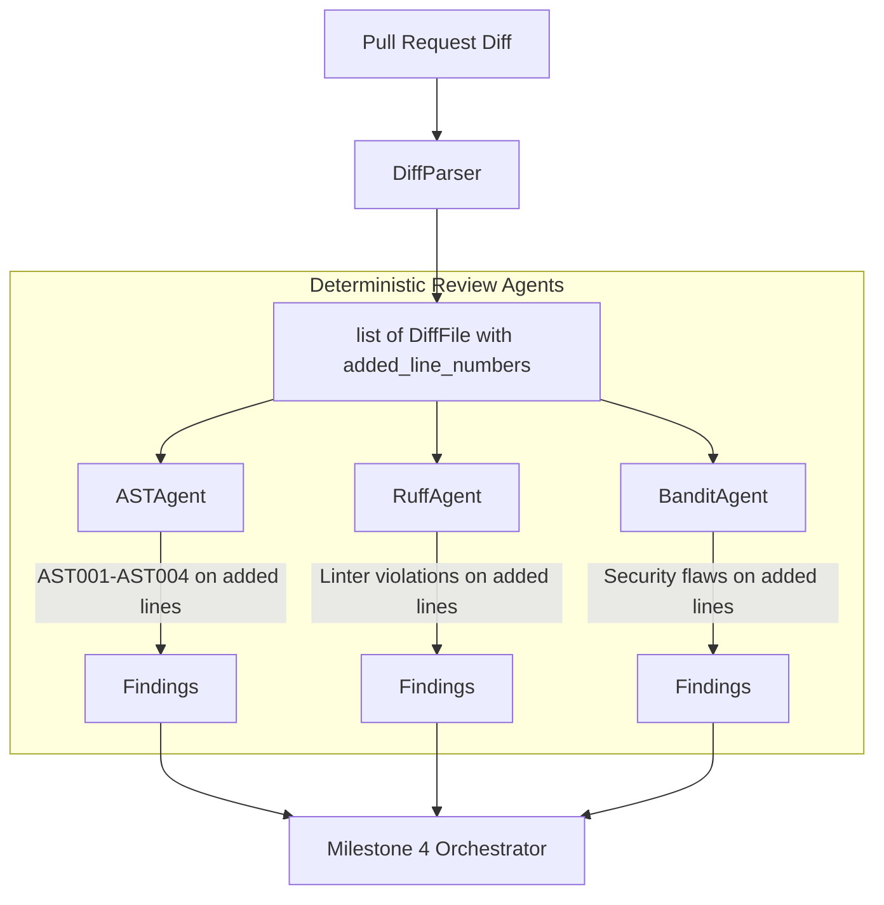

# Milestone 3 — Deterministic Review Agents

**Status:** Complete
**Tests:** 50 new tests (124 total passing, 94% coverage)
**Linter:** Ruff clean

---

## 1. Overview & Objective

Milestone 3 creates three deterministic review agents that run locally without any AI or LLM dependency:
1. **AST Agent (`ASTAgent`)**: Uses Python's built-in `ast` module to analyze syntax trees for structural issues, cyclomatic complexity, deep nesting, function length, wildcard imports, and syntax errors.
2. **Ruff Agent (`RuffAgent`)**: Executes `ruff check --output-format json` to surface code quality, style, and bug risks on changed lines.
3. **Bandit Agent (`BanditAgent`)**: Executes `bandit -f json -q` to identify security vulnerabilities (SQL injection, hardcoded passwords, insecure imports, shell injection) on changed lines.

### Why Deterministic Agents First?
Deterministic agents establish a stable, zero-cost, zero-latency baseline. When AI/LLM review agents are added in Milestone 5, this baseline provides the benchmark to measure what AI catches beyond static analysis tools.

---

## 2. Components & Files Created

| File | Type | Purpose |
|------|------|---------|
| [`src/code_review/agents/ast_agent.py`](file:///e:/Projects/Multi%20Agent%20Code%20Review%20System/src/code_review/agents/ast_agent.py) | Concrete Agent | Analyzes Python ASTs for cyclomatic complexity (`AST001`), deep nesting (`AST002`), overly long functions (`AST003`), wildcard imports (`AST004`), and syntax errors (`AST000`). |
| [`src/code_review/agents/ruff_agent.py`](file:///e:/Projects/Multi%20Agent%20Code%20Review%20System/src/code_review/agents/ruff_agent.py) | Concrete Agent | Wraps Ruff linter via subprocess, parses JSON output diagnostics, maps rule codes to categories/severities, and incorporates automated fixes as suggestions. |
| [`src/code_review/agents/bandit_agent.py`](file:///e:/Projects/Multi%20Agent%20Code%20Review%20System/src/code_review/agents/bandit_agent.py) | Concrete Agent | Wraps Bandit security scanner via subprocess, parses JSON findings, maps severity (`HIGH` -> `CRITICAL`, `MEDIUM` -> `WARNING`, `LOW` -> `INFO`), and provides remediation advice. |
| [`src/code_review/agents/__init__.py`](file:///e:/Projects/Multi%20Agent%20Code%20Review%20System/src/code_review/agents/__init__.py) | Package Init | Re-exports `BaseAgent`, `ASTAgent`, `RuffAgent`, and `BanditAgent`. |
| [`tests/fixtures/sample_complex.py`](file:///e:/Projects/Multi%20Agent%20Code%20Review%20System/tests/fixtures/sample_complex.py) | Test Fixture | Python file with high cyclomatic complexity, deep nesting (> 4), long function (> 50 lines), and wildcard import. |
| [`tests/fixtures/sample_lint_issues.py`](file:///e:/Projects/Multi%20Agent%20Code%20Review%20System/tests/fixtures/sample_lint_issues.py) | Test Fixture | Python file with deliberate linting defects (unused imports, unused local variables). |
| [`tests/fixtures/sample_security.py`](file:///e:/Projects/Multi%20Agent%20Code%20Review%20System/tests/fixtures/sample_security.py) | Test Fixture | Python file with security flaws (hardcoded secrets, `os.system`, `subprocess.run(shell=True)`, `eval`, and SQL injection). |
| [`tests/test_ast_agent.py`](file:///e:/Projects/Multi%20Agent%20Code%20Review%20System/tests/test_ast_agent.py) | Unit Tests | 18 tests covering AST metrics, complexity calculation, nesting depth, function length, wildcard imports, syntax errors, and diff filtering. |
| [`tests/test_ruff_agent.py`](file:///e:/Projects/Multi%20Agent%20Code%20Review%20System/tests/test_ruff_agent.py) | Unit Tests | 15 tests covering Ruff CLI execution, output JSON parsing, rule code category/severity mappings, fix extraction, and error handling. |
| [`tests/test_bandit_agent.py`](file:///e:/Projects/Multi%20Agent%20Code%20Review%20System/tests/test_bandit_agent.py) | Unit Tests | 17 tests covering Bandit scanner execution, JSON report parsing, severity level translation, remediation recommendations, and diff filtering. |

---

## 3. Architecture & Data Flow



### Key Design Decisions
- **Added Line Filtering**: Every agent strictly restricts emitted findings to lines touched in the pull request (`diff_file.added_line_numbers`), avoiding noisy review comments on pre-existing legacy code.
- **Robust Subprocess Execution**: External tools (`ruff` and `bandit`) are executed using `[sys.executable, "-m", "<tool>"]` with explicit timeouts and error traps for `TimeoutExpired` and `FileNotFoundError`.
- **Pure Parsing Hooks**: Each agent exposes standalone parsing methods (`analyze_source`, `parse_ruff_output`, `parse_bandit_output`) allowing unit tests to execute in milliseconds without launching external subprocesses unless testing integration.

---

## 4. Dependencies

| Dependency | Category | Purpose |
|------------|----------|---------|
| `bandit>=1.7.0` | Core | Security vulnerability scanner for Python AST. |
| `ruff>=0.4.0` | Dev / Tooling | Fast Rust-based linter and code formatter. |

---

## 5. Verification Commands

```powershell

.venv\Scripts\python.exe -m pytest

.venv\Scripts\python.exe -m pytest --cov=src/code_review

.venv\Scripts\python.exe -m ruff check .
```
