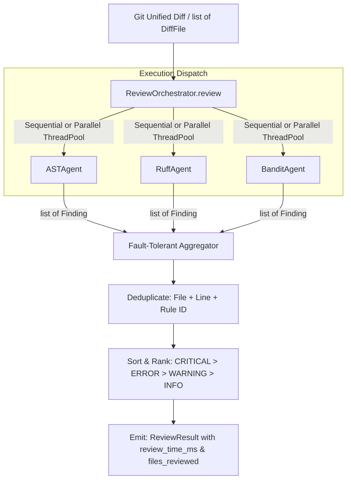

# Milestone 4 — Review Orchestrator

**Status:**  Complete
**Tests:** 51 new tests (175 total passing, 95% coverage)
**Linter:** Ruff clean

---

## 1. Overview & Objective

Milestone 4 implements the **Review Orchestrator** (`ReviewOrchestrator`), the central coordinator of the multi-agent code review system. While specialist review agents (AST, Ruff, Bandit, and future LLM agents) focus on discovering issues within their respective domains, the orchestrator acts as the "Lead Reviewer" / "Editor-in-Chief":
1. **Agent Coordination & Lifecycle**: Maintains a registry of active review agents and dispatches diff reviews sequentially or concurrently in parallel via a thread pool.
2. **Fault Isolation**: Traps unhandled exceptions from crashing agents, ensuring resilient execution where healthy agents continue and produce results.
3. **Cross-Agent Deduplication**: Merges overlapping findings across multiple tools reporting on the same file and line, preserving the most severe finding and richest fix suggestions.
4. **Severity Ranking & Deterministic Ordering**: Sorts findings by severity rank (`CRITICAL` > `ERROR` > `WARNING` > `INFO`), tie-breaking deterministically by file path and line number.
5. **Unified Reporting**: Computes wall-clock execution metrics (`review_time_ms`), tracks reviewed file counts, and emits a validated [`ReviewResult`](file:///e:/Projects/Multi%20Agent%20Code%20Review%20System/src/code_review/models/review.py).

---

## 2. Components & Files Created / Updated

| File | Type | Purpose |
|------|------|---------|
| [`src/code_review/orchestrator.py`](file:///e:/Projects/Multi%20Agent%20Code%20Review%20System/src/code_review/orchestrator.py) | Core Component | Implements `ReviewOrchestrator` (and `Orchestrator` alias), `deduplicate_findings()`, `sort_findings()`, and `default_agents()` factory. |
| [`src/code_review/__init__.py`](file:///e:/Projects/Multi%20Agent%20Code%20Review%20System/src/code_review/__init__.py) | Package Init | Re-exports `ReviewOrchestrator`, `Orchestrator`, `deduplicate_findings`, `sort_findings`, and `default_agents`. |
| [`tests/test_orchestrator.py`](file:///e:/Projects/Multi%20Agent%20Code%20Review%20System/tests/test_orchestrator.py) | Test Suite | 51 unit and integration tests covering initialization, agent registry, deduplication, sorting, sequential/parallel execution, fault tolerance, severity filtering, input dispatching, and end-to-end multi-agent runs. |

---

## 3. Architecture & Data Flow



### Key Design Decisions
- **Fault-Tolerant Execution**: External linters or tools may fail (e.g. missing executable or corrupted environment). The orchestrator catches `Exception` per agent, logs full tracebacks to stderr, records errors in `orchestrator.last_errors`, and proceeds with results from surviving agents.
- **Sequential & Concurrent Parallel Execution**: Supports both sequential execution (default, predictable) and parallel concurrency via `ThreadPoolExecutor` (releasing the GIL during subprocess calls in `Ruff` and `Bandit`). Both modes yield identical, deterministic findings.
- **Intelligent Deduplication**: When multiple agents report on the same `(file, line, rule_id)` (or same message when rule ID is absent), the orchestrator resolves duplicates by preserving the finding with higher severity rank, and in case of ties, preferring the finding that includes an actionable `suggestion`.
- **Severity-Rank Ordering**: Findings are automatically ordered from most severe (`CRITICAL`) to least severe (`INFO`). Secondary sorting by file path and line number guarantees deterministic output ordering for downstream CLI reporters and GitHub review comment post-processors.
- **Flexible Review API**: The unified `orchestrator.review()` entry point seamlessly accepts either raw git diff strings or pre-parsed `list[DiffFile]` objects.

---

## 4. Test Coverage Summary

- **Total Tests:** 175 passing across 9 test suites
- **Milestone 4 Tests:** 51 tests in [`tests/test_orchestrator.py`](file:///e:/Projects/Multi%20Agent%20Code%20Review%20System/tests/test_orchestrator.py)
- **Code Coverage:** 100% on `src/code_review/orchestrator.py` (95% overall repository coverage)

---

## 5. Verification Commands

```powershell

.venv\Scripts\python.exe -m pytest

.venv\Scripts\python.exe -m pytest --cov=src/code_review

.venv\Scripts\python.exe -m ruff check .
```
