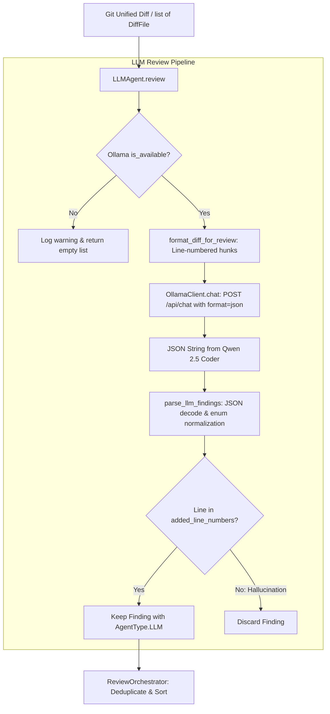

# Milestone 5 — LLM Integration (Ollama + Qwen 2.5 Coder)

**Status:**  Complete
**Tests:** 31 new tests (208 total passing, 94% coverage)
**Linter:** Ruff clean

---

## 1. Overview & Objective

Milestone 5 adds the **LLM-Powered Review Agent** (`LLMAgent`) to the multi-agent code review system. While deterministic review agents (AST, Ruff, Bandit) reliably discover structural flaws, syntax issues, and known CVEs, they cannot evaluate semantic logic, contextual correctness, or subtle algorithmic risks.

The `LLMAgent` integrates with local models via **Ollama** (specifically **Qwen 2.5 Coder**):
1. **Semantic Code Inspection**: Detects subtle logic bugs, off-by-one errors, division by zero, unhandled edge cases, mutable default arguments, and resource leaks (unclosed file handles).
2. **Local & Private Execution**: Uses local inference with zero third-party cloud API costs, no rate limits, and 100% data privacy.
3. **Constrained JSON Generation**: Employs Ollama's constrained grammar mode (`format: "json"`) to ensure syntactically valid JSON responses adhering to the [`Finding`](file:///e:/Projects/Multi%20Agent%20Code%20Review%20System/src/code_review/models/finding.py) schema.
4. **Anti-Hallucination Line Filtering**: Compares model citations against `diff_file.added_line_numbers`, strictly discarding any reported issues on unchanged or non-added lines.
5. **Zero-Dependency Transport**: Implements a resilient HTTP client using Python's standard library (`urllib.request`), featuring automatic health checks and graceful fallback when the model or service is offline.

---

## 2. Components & Files Created / Updated

| File | Type | Purpose |
|------|------|---------|
| [`src/code_review/config.py`](file:///e:/Projects/Multi%20Agent%20Code%20Review%20System/src/code_review/config.py) | Configuration | Added `llm_provider`, `llm_model`, `llm_base_url`, `llm_timeout_seconds`, and `llm_temperature`. |
| [`.env.example`](file:///e:/Projects/Multi%20Agent%20Code%20Review%20System/.env.example) / [`.env`](file:///e:/Projects/Multi%20Agent%20Code%20Review%20System/.env) | Configuration | Activated LLM environment variable settings. |
| [`src/code_review/llm/client.py`](file:///e:/Projects/Multi%20Agent%20Code%20Review%20System/src/code_review/llm/client.py) | LLM Client | Implements `OllamaClient` using standard library `urllib`, supporting `is_available()`, `list_models()`, constrained JSON completions, and typed exceptions (`OllamaTimeoutError`, `OllamaConnectionError`, `OllamaResponseError`). |
| [`src/code_review/llm/prompts.py`](file:///e:/Projects/Multi%20Agent%20Code%20Review%20System/src/code_review/llm/prompts.py) | Prompts & Parser | Defines `REVIEW_SYSTEM_PROMPT`, `format_diff_for_review()`, and `parse_llm_findings()`. Normalizes enums and enforces strict diff line filtering. |
| [`src/code_review/llm/__init__.py`](file:///e:/Projects/Multi%20Agent%20Code%20Review%20System/src/code_review/llm/__init__.py) | Package Init | Re-exports `OllamaClient`, exceptions, prompt templates, and parsers. |
| [`src/code_review/agents/llm_agent.py`](file:///e:/Projects/Multi%20Agent%20Code%20Review%20System/src/code_review/agents/llm_agent.py) | Review Agent | Implements `LLMAgent` extending `BaseAgent` (`AgentType.LLM`). Coordinates diff prompting, inference, parsing, and fault-tolerant error boundaries. |
| [`src/code_review/agents/__init__.py`](file:///e:/Projects/Multi%20Agent%20Code%20Review%20System/src/code_review/agents/__init__.py) | Package Init | Re-exports `LLMAgent`. |
| [`src/code_review/orchestrator.py`](file:///e:/Projects/Multi%20Agent%20Code%20Review%20System/src/code_review/orchestrator.py) | Orchestration | Updated `default_agents(include_llm=False)` and `ReviewOrchestrator(include_llm=False)` to seamlessly incorporate `LLMAgent`. |
| [`tests/fixtures/sample_logic_bugs.py`](file:///e:/Projects/Multi%20Agent%20Code%20Review%20System/tests/fixtures/sample_logic_bugs.py) | Fixture | Contains intentional semantic bugs (zero division, mutable default args, unclosed file descriptors, index errors, exception swallowing). |
| [`tests/fixtures/sample_logic.diff`](file:///e:/Projects/Multi%20Agent%20Code%20Review%20System/tests/fixtures/sample_logic.diff) | Fixture | Realistic Git unified diff introducing logic bugs. |
| [`tests/test_llm_agent.py`](file:///e:/Projects/Multi%20Agent%20Code%20Review%20System/tests/test_llm_agent.py) | Test Suite | 31 unit, orchestrator, and live integration tests for client, prompts, parser, and agent. |

---

## 3. Architecture & Data Flow



### Key Design Decisions
- **Constrained JSON Mode (`format: "json"`)**: Ollama forces the sampler to conform to JSON grammar during token generation. This guarantees that model responses parse without regex hackery or markdown stripping failures.
- **Strict Anti-Hallucination Gate**: LLMs occasionally reference lines in surrounding context or hallucinate arbitrary line numbers. `parse_llm_findings` verifies every finding against `diff_file.added_line_numbers`. Any finding not touching an added line is safely discarded.
- **Resilient Fault Isolation**: If the Ollama server is stopped, offline, or times out on large diffs, `LLMAgent` catches the error, logs a warning, and returns an empty list. Surviving deterministic agents continue unhindered.
- **Dual Execution Modes**: `default_agents(include_llm=False)` ensures test suites and fast CI pipelines remain purely deterministic and sub-second. Passing `include_llm=True` or registering `LLMAgent` activates the AI reviewer.

---

## 4. Test Coverage Summary

- **Total Tests:** 208 passing across 10 test suites
- **Milestone 5 Tests:** 31 tests in [`tests/test_llm_agent.py`](file:///e:/Projects/Multi%20Agent%20Code%20Review%20System/tests/test_llm_agent.py) (covering mock errors, timeouts, prompt formatting, validation, orchestrator integration, and live Ollama execution)
- **Repository Code Coverage:** 94% overall repository coverage (100% on `orchestrator.py` and `config.py`, 96% on `client.py`, 89% on `llm_agent.py` and `prompts.py`)

---

## 5. Verification Commands

```powershell

.venv\Scripts\python.exe -m pytest

.venv\Scripts\python.exe -m pytest --cov=src/code_review

.venv\Scripts\python.exe -m ruff check .
```
