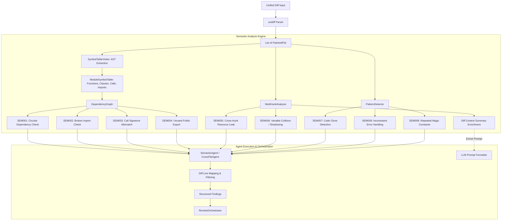

# Milestone 8 — Advanced Analysis (Cross-File & Semantic Review)

**Status:** [Complete] Complete
**Tests:** 29 new tests (313 total passing, 100% pass rate)
**Linter:** Ruff clean

---

## 1. Overview & Objective

Traditional static analysis and LLM reviews often evaluate diffs on a file-by-file or hunk-by-hunk basis. This creates critical blind spots:
1. **Cross-file breakages**: Renaming or altering a function's parameters in file A silently breaks call sites in file B.
2. **Circular dependencies**: Importing modules across new files can introduce runtime import cycles (`ImportError`).
3. **Multi-hunk resource leaks**: A resource (such as a file handle, socket, or lock) opened in one hunk without being closed or used in a context manager in subsequent hunks within the same file.
4. **Variable collisions**: A variable defined in an early hunk is accidentally re-used or shadowed in a later hunk, creating state pollution.
5. **Architectural anti-patterns**: Unused public exports, duplicate code clones, repeated magic constants, and silently swallowed exceptions.

Milestone 8 introduces the **Advanced Semantic Analysis Engine** and the **SemanticAgent** (`CrossFileAgent`), equipping NEXARION with cross-file symbol dependency tracking, multi-hunk semantic context synthesis, and code pattern detection.

---

## 2. Architecture & Data Flow



### Key Analytical Subsystems

1. **Symbol Table Extraction (`symbol_table.py`)**:
   - Parses ASTs for each changed file into a `ModuleSymbolTable`.
   - Records defined functions and methods (`FunctionSymbol`), including position-only args, keyword-only args, varargs (`*args`), kwargs (`**kwargs`), and defaults.
   - Records defined classes and method members (`ClassSymbol`).
   - Extracts all module-level and function-level imports (`ImportSymbol`).
   - Tracks outgoing function calls (`CallSite`) with positional and keyword arguments.
   - Resolves `__all__` exports and module-level top-level public names.

2. **Cross-File Dependency Graph (`dependency_graph.py`)**:
   - Builds an import dependency directed graph across all changed files.
   - Detects circular module import chains using Depth-First Search cycle detection.
   - Cross-references imports against defined symbols in target modules to spot broken imports.
   - Verifies call sites against target function signatures to detect argument count and keyword mismatches.
   - Flags public exported symbols in modified modules that have zero references across the codebase.

3. **Multi-Hunk Analysis (`multi_hunk.py`)**:
   - Compares consecutive added hunks within the same file.
   - Detects opened resources (e.g. `open(...)`, `connect(...)`, `socket(...)`, `acquire(...)`) that are not wrapped in a `with` statement and have no corresponding `.close()` or `.release()` call in subsequent hunks.
   - Flags variable collisions and scope shadowing where global/outer variables defined in earlier hunks are reassigned in later hunks.
   - Synthesizes a structured `MultiHunkContextSummary` highlighting modified symbols and hunks for injection into LLM review prompts.

4. **Pattern & Anti-Pattern Detection (`patterns.py`)**:
   - **Code Clone Detection**: Normalizes AST statements (stripping docstrings and variable names) and computes statement sequence similarity via Jaccard/sliding-window hashing.
   - **Inconsistent Error Handling**: Flags bare `except:` statements and swallowed exceptions with empty `pass` blocks that omit logging or re-raising.
   - **Repeated Magic Constants**: Detects recurring numeric or string literals (>= 3 occurrences) that should be refactored into named constants.

---

## 3. Rules Catalog (`SEM001` – `SEM009`)

| Rule ID | Name | Severity | Category | Description |
|---------|------|----------|----------|-------------|
| **SEM001** | `circular-dependency` | `WARNING` | `ARCHITECTURE` | Circular import dependency detected between two or more modified modules. |
| **SEM002** | `broken-import` | `ERROR` | `BUG_RISK` | Imported symbol is not defined or exported in the target module. |
| **SEM003** | `signature-mismatch` | `ERROR` | `BUG_RISK` | Function call does not match the target function parameter signature (missing/extra arguments). |
| **SEM004** | `unused-export` | `INFO` | `CODE_QUALITY` | Public symbol in `__all__` or exported module namespace is never referenced. |
| **SEM005** | `cross-hunk-resource-leak` | `WARNING` | `RESOURCE_LEAK` | Resource opened in one hunk is not closed or managed across subsequent hunks. |
| **SEM006** | `cross-hunk-var-collision` | `WARNING` | `BUG_RISK` | Variable defined in an earlier hunk is shadowed or reassigned in a subsequent hunk. |
| **SEM007** | `code-clone` | `INFO` | `CODE_QUALITY` | Substantial block of duplicate or near-duplicate code found across functions or files. |
| **SEM008** | `swallowed-exception` | `WARNING` | `ERROR_HANDLING` | Exception caught by bare `except` or empty block with `pass` without logging or re-raising. |
| **SEM009** | `repeated-magic-constant` | `INFO` | `CODE_QUALITY` | Magic numeric or string literal repeated multiple times instead of a named constant. |

---

## 4. Components & Files Created / Modified

| File | Type | Purpose |
|------|------|---------|
| [`src/code_review/models/enums.py`](file:///e:/Projects/Multi%20Agent%20Code%20Review%20System/src/code_review/models/enums.py) | Modified | Added `AgentType.SEMANTIC = "semantic"`. |
| [`src/code_review/analysis/symbol_table.py`](file:///e:/Projects/Multi%20Agent%20Code%20Review%20System/src/code_review/analysis/symbol_table.py) | Created | AST visitor extracting functions, classes, imports, call sites, and `__all__` exports. |
| [`src/code_review/analysis/dependency_graph.py`](file:///e:/Projects/Multi%20Agent%20Code%20Review%20System/src/code_review/analysis/dependency_graph.py) | Created | Cross-file dependency graph with circular import, broken import, signature, and export checks. |
| [`src/code_review/analysis/multi_hunk.py`](file:///e:/Projects/Multi%20Agent%20Code%20Review%20System/src/code_review/analysis/multi_hunk.py) | Created | Multi-hunk resource leak analysis, variable shadowing, and prompt context summary builder. |
| [`src/code_review/analysis/patterns.py`](file:///e:/Projects/Multi%20Agent%20Code%20Review%20System/src/code_review/analysis/patterns.py) | Created | Pattern detector for code clones, swallowed exceptions, and repeated magic constants. |
| [`src/code_review/analysis/__init__.py`](file:///e:/Projects/Multi%20Agent%20Code%20Review%20System/src/code_review/analysis/__init__.py) | Created | Re-exports all AST symbol, graph, multi-hunk, and pattern utilities. |
| [`src/code_review/agents/semantic_agent.py`](file:///e:/Projects/Multi%20Agent%20Code%20Review%20System/src/code_review/agents/semantic_agent.py) | Created | Implements `SemanticAgent` (`CrossFileAgent`) implementing the `BaseAgent` contract. |
| [`src/code_review/agents/__init__.py`](file:///e:/Projects/Multi%20Agent%20Code%20Review%20System/src/code_review/agents/__init__.py) | Modified | Re-exports `SemanticAgent` and `CrossFileAgent`. |
| [`src/code_review/orchestrator.py`](file:///e:/Projects/Multi%20Agent%20Code%20Review%20System/src/code_review/orchestrator.py) | Modified | Added `include_semantic: bool = False` parameter to `default_agents()` and `ReviewOrchestrator`. |
| [`src/code_review/cli/main.py`](file:///e:/Projects/Multi%20Agent%20Code%20Review%20System/src/code_review/cli/main.py) | Modified | Added `--semantic` CLI flag and registered `"semantic"` / `"cross_file"` in `AGENT_MAP`. |
| [`src/code_review/llm/prompts.py`](file:///e:/Projects/Multi%20Agent%20Code%20Review%20System/src/code_review/llm/prompts.py) | Modified | Enriched `format_diff_for_review` with multi-hunk context summary when multiple hunks exist. |
| [`src/code_review/db/init_db.py`](file:///e:/Projects/Multi%20Agent%20Code%20Review%20System/src/code_review/db/init_db.py) | Modified | Registered `semantic` agent in PostgreSQL default seed catalog (`DEFAULT_AGENTS`). |
| [`src/code_review/web/routes/review_routes.py`](file:///e:/Projects/Multi%20Agent%20Code%20Review%20System/src/code_review/web/routes/review_routes.py) | Modified | Enabled `include_semantic` in web review orchestration. |
| [`src/code_review/web/routes/github_routes.py`](file:///e:/Projects/Multi%20Agent%20Code%20Review%20System/src/code_review/web/routes/github_routes.py) | Modified | Enabled `include_semantic` in GitHub PR review orchestration. |
| [`tests/fixtures/sample_cross_file_broken.diff`](file:///e:/Projects/Multi%20Agent%20Code%20Review%20System/tests/fixtures/sample_cross_file_broken.diff) | Created | Multi-file diff fixture with broken imports, call signature mismatches, and circular imports. |
| [`tests/fixtures/sample_multi_hunk_leak.diff`](file:///e:/Projects/Multi%20Agent%20Code%20Review%20System/tests/fixtures/sample_multi_hunk_leak.diff) | Created | Multi-hunk diff fixture with unclosed resource descriptors and variable collisions. |
| [`tests/test_analysis.py`](file:///e:/Projects/Multi%20Agent%20Code%20Review%20System/tests/test_analysis.py) | Created | 18 unit tests verifying symbol table, dependency graph, multi-hunk, and pattern algorithms. |
| [`tests/test_semantic_agent.py`](file:///e:/Projects/Multi%20Agent%20Code%20Review%20System/tests/test_semantic_agent.py) | Created | 11 unit and integration tests verifying `SemanticAgent`, orchestrator, and CLI options. |

---

## 5. Usage & Examples

### Command-Line Interface (CLI)

```bash

code-review --semantic

code-review --agents semantic,ast path/to/patch.diff

code-review --semantic --fail-on warning
```

### Python API

```python
from code_review.orchestrator import ReviewOrchestrator
from code_review.agents import SemanticAgent

orchestrator = ReviewOrchestrator(include_semantic=True)

result = orchestrator.review_diff(diff_content)

for finding in result.findings:
    if finding.agent == "semantic":
        print(f"[{finding.rule_id}] {finding.file}:{finding.line} - {finding.message}")
```

---

## 6. Verification & Test Results

- **Unit & Integration Tests**: 29 new tests across `tests/test_analysis.py` and `tests/test_semantic_agent.py`.
- **Full Suite**: 313/313 passed with 0 failures (`pytest`).
- **Code Quality & Linter**: 0 errors on Ruff across all Milestone 8 files.
- **Frontend Build**: `npm run build` cleanly compiled Vite bundle without errors.
