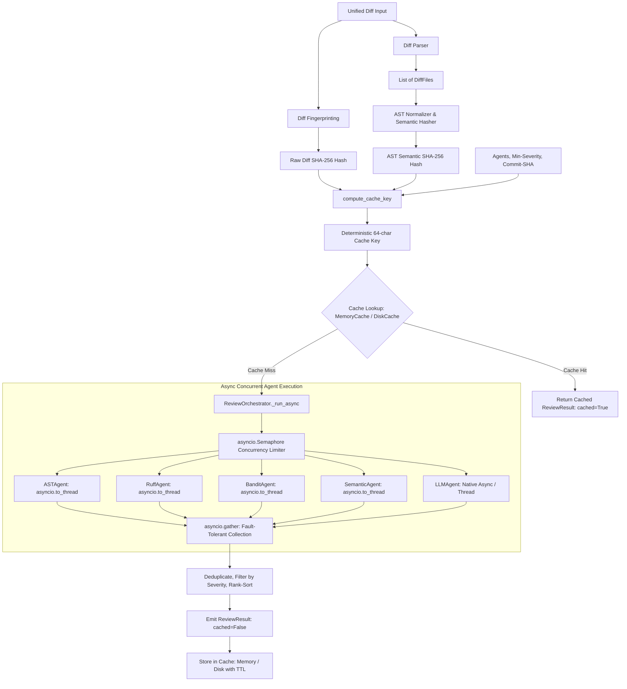

# Milestone 9 — Caching & Performance

**Status:** [Complete] Complete
**Tests:** 32 new tests (345 total passing, 100% pass rate)
**Linter:** Ruff clean

---

## 1. Overview & Objective

Running a comprehensive multi-agent code review — involving syntactic AST analysis, linting (Ruff), security scanning (Bandit), cross-file dependency graph checks, and local/cloud LLM inference — can take from several seconds up to minutes on large pull requests.

In typical software development workflows:
1. Developers push multiple commits in rapid succession that touch only small portions of a PR.
2. Automated CI pipelines frequently re-trigger reviews on identical commit SHAs or rebases.
3. Developers make cosmetic changes (e.g. fixing whitespace, wrapping comments, or tweaking docstrings) that do not alter the underlying code logic or semantics.

Milestone 9 introduces **Review Result Caching** and **Async Performance Optimization** to NEXARION:
- **Two-Tier Caching Architecture**: In-memory LRU cache (`MemoryCache`) for sub-millisecond in-session lookups and persistent filesystem storage (`DiskCache`) for cross-process reuse.
- **AST Semantic Hashing**: Parses and normalizes abstract syntax trees (stripping positions, docstrings, and comment noise) so that cosmetic formatting edits hit the cache without re-running expensive review agents.
- **Asynchronous Agent Orchestration**: Native `asyncio` parallel agent dispatch (`review_async`, `review_diff_async`, `review_files_async`), running CPU-bound agents via `asyncio.to_thread` and bounding external concurrency with `asyncio.Semaphore`.

---

## 2. Architecture & Data Flow



### Key Analytical Subsystems

1. **Deterministic Fingerprinting & Keys (`cache/keys.py`)**:
   - `normalize_diff_text()` converts CRLF to LF, strips trailing line whitespace, and removes extraneous blank lines.
   - `compute_diff_hash()` produces a cryptographic SHA-256 digest of the normalized diff.
   - `compute_cache_key()` produces a canonical 64-character hash combining the diff hash, commit SHA, sorted active agent names, severity threshold, and semantic AST hash.

2. **In-Memory LRU Cache (`cache/memory_cache.py`)**:
   - Thread-safe storage with `threading.Lock`.
   - `collections.OrderedDict` provides O(1) Least-Recently-Used eviction when `maxsize` is reached.
   - Configurable per-entry or default TTL with automatic expiration checks on read.
   - High-resolution hit/miss/eviction metric tracking.

3. **Persistent Disk Cache (`cache/disk_cache.py`)**:
   - Filesystem persistence across CLI executions and service restarts.
   - Atomic file writes using temporary files and atomic `os.replace` to prevent corrupted reads under concurrency.
   - Automatic TTL validation and background expired entry pruning (`prune()`).

4. **AST Semantic Hasher (`analysis/ast_hasher.py`)**:
   - `ASTNormalizer` walks the Python AST and removes line numbers, column offsets, and docstrings.
   - `compute_ast_hash()` dumps the canonical AST via `ast.dump(tree, annotate_fields=False, include_attributes=False)`.
   - `is_semantically_identical()` proves whether two code blocks have identical syntax logic despite formatting or comment changes.
   - `compute_diff_semantic_hash()` extracts and aggregates AST hashes for added lines across all changed files.

5. **Async Concurrency (`orchestrator.py` & `agents/base.py`)**:
   - `BaseAgent.review_async()` defaults to non-blocking execution via `asyncio.to_thread(self.review, diff_files)`.
   - `ReviewOrchestrator._run_async()` coordinates all agents with `asyncio.gather`, ensuring that an exception in one agent does not cancel others.
   - `asyncio.Semaphore` bounds maximum concurrency to protect system memory and API rate limits.

---

## 3. Components & Files Created / Modified

| File | Type | Purpose |
|------|------|---------|
| [`src/code_review/cache/base.py`](file:///e:/Projects/Multi%20Agent%20Code%20Review%20System/src/code_review/cache/base.py) | Created | `BaseCache` abstract interface and `CacheEntry` dataclass with TTL support. |
| [`src/code_review/cache/keys.py`](file:///e:/Projects/Multi%20Agent%20Code%20Review%20System/src/code_review/cache/keys.py) | Created | `compute_diff_hash`, `normalize_diff_text`, and `compute_cache_key`. |
| [`src/code_review/cache/memory_cache.py`](file:///e:/Projects/Multi%20Agent%20Code%20Review%20System/src/code_review/cache/memory_cache.py) | Created | Thread-safe in-memory cache with LRU eviction and TTL expiration. |
| [`src/code_review/cache/disk_cache.py`](file:///e:/Projects/Multi%20Agent%20Code%20Review%20System/src/code_review/cache/disk_cache.py) | Created | Persistent filesystem cache with atomic writes and corrupted file recovery. |
| [`src/code_review/cache/__init__.py`](file:///e:/Projects/Multi%20Agent%20Code%20Review%20System/src/code_review/cache/__init__.py) | Created | Public exports for caching subsystem. |
| [`src/code_review/analysis/ast_hasher.py`](file:///e:/Projects/Multi%20Agent%20Code%20Review%20System/src/code_review/analysis/ast_hasher.py) | Created | Normalized AST structural hashing and semantic equivalence detection. |
| [`src/code_review/models/review.py`](file:///e:/Projects/Multi%20Agent%20Code%20Review%20System/src/code_review/models/review.py) | Modified | Added `cached: bool = False` field to `ReviewResult`. |
| [`src/code_review/agents/base.py`](file:///e:/Projects/Multi%20Agent%20Code%20Review%20System/src/code_review/agents/base.py) | Modified | Added `review_async()` method with `asyncio.to_thread` fallback. |
| [`src/code_review/orchestrator.py`](file:///e:/Projects/Multi%20Agent%20Code%20Review%20System/src/code_review/orchestrator.py) | Modified | Added cache integration, `review_async`, `review_diff_async`, `review_files_async`, and `_run_async`. |
| [`src/code_review/config.py`](file:///e:/Projects/Multi%20Agent%20Code%20Review%20System/src/code_review/config.py) | Modified | Added cache settings: `cache_enabled`, `cache_backend`, `cache_dir`, `cache_ttl_seconds`, `max_concurrency`. |
| [`src/code_review/cli/main.py`](file:///e:/Projects/Multi%20Agent%20Code%20Review%20System/src/code_review/cli/main.py) | Modified | Added `--no-cache`, `--cache-dir`, `--clear-cache`, and `--semantic-cache` CLI options. |
| [`src/code_review/cli/formatter.py`](file:///e:/Projects/Multi%20Agent%20Code%20Review%20System/src/code_review/cli/formatter.py) | Modified | Added `[CACHED]` badge to terminal summary panel. |
| [`tests/test_cache.py`](file:///e:/Projects/Multi%20Agent%20Code%20Review%20System/tests/test_cache.py) | Created | 17 unit tests for hashing, MemoryCache (LRU, TTL, stats), and DiskCache (persistence, atomic writes). |
| [`tests/test_ast_hasher.py`](file:///e:/Projects/Multi%20Agent%20Code%20Review%20System/tests/test_ast_hasher.py) | Created | 6 unit tests for AST normalization, comment/whitespace invariance, and diff semantic hashing. |
| [`tests/test_async_orchestrator.py`](file:///e:/Projects/Multi%20Agent%20Code%20Review%20System/tests/test_async_orchestrator.py) | Created | 9 integration tests for async dispatch, parallel speedup, fault tolerance, and cache hits. |

---

## 4. Usage & Examples

### Command-Line Interface (CLI)

```bash

code-review

code-review --no-cache

code-review --clear-cache

code-review --cache-dir /tmp/my_cache
```

### Python API (Synchronous & Asynchronous)

```python
import asyncio
from code_review.orchestrator import ReviewOrchestrator
from code_review.cache import DiskCache

cache = DiskCache(cache_dir=".cache/code_review")
orchestrator = ReviewOrchestrator(cache=cache, use_cache=True, use_semantic_hash=True)

result = orchestrator.review_diff(diff_content)
if result.cached:
    print(f"Review retrieved from cache in {result.review_time_ms}ms!")

async def main():
    res = await orchestrator.review_diff_async(diff_content)
    print(f"Async review completed with {res.total_findings} findings.")

asyncio.run(main())
```

---

## 5. Verification & Test Results

- **New Tests**: 32 tests across [`tests/test_cache.py`](file:///e:/Projects/Multi%20Agent%20Code%20Review%20System/tests/test_cache.py) (17 tests), [`tests/test_ast_hasher.py`](file:///e:/Projects/Multi%20Agent%20Code%20Review%20System/tests/test_ast_hasher.py) (6 tests), and [`tests/test_async_orchestrator.py`](file:///e:/Projects/Multi%20Agent%20Code%20Review%20System/tests/test_async_orchestrator.py) (9 tests).
- **Full Suite**: **345 passed** across all modules with 0 failures (`pytest`).
- **Code Quality**: 0 errors on Ruff across all Milestone 9 files.
- **Performance**: Async parallel execution verified to scale sub-linearly and reduce total review time compared to sequential execution.
